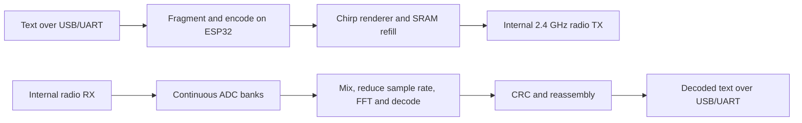

# ESP32-S3 autonomous LoRa-style serial modem — INFO19

This firmware sends and receives text using the **ESP32-S3's built-in 2.4 GHz
Wi-Fi radio**, repurposed as a raw I/Q radio. It needs no external LoRa chip.
The ESP32 performs packet encoding, chirp generation, transmit-buffer refill,
continuous sample acquisition, demodulation, CRC checking and message reassembly.
The computer supplies text over USB serial and receives decoded text.

**Status: working engineering prototype, experimental SF7 / 1.25 MHz bandwidth.**
Two ESP32-S3 boards passed bidirectional terminal and GUI message tests. The
bandwidth and application framing are custom; commercial Semtech-radio
interoperability, LoRaWAN, reliable range and indefinite uptime are unverified.
USB disconnect errors and an intermittent delivery failure remain unresolved.
See [validation and limits](docs/VALIDATION.md) for successes and failures.

This folder is a standalone export of the tested INFO19 release. It includes
source, exact tested flash images, configuration, portable host tools and notices.
The local research workspace, serial identities, chat history, flash backups,
RF captures, installed SDK and virtual environments are not part of the export.

## Quick start: use the prebuilt firmware

Tested hardware: LilyGO T-Dongle S3 / ESP32-S3, with native USB Serial/JTAG.
The image declares **2 MB flash, DIO, 80 MHz**, with one 1 MB application partition.
The tested boards physically have 16 MB flash; the image uses the 2 MB layout.
It uses both CPU cores at 240 MHz and does not require PSRAM. Other ESP32 families
are unsupported. Other S3 boards and physical UART pins need their own validation.

Install Python 3.10+ and the host tools. The requirements pin
[pyserial 3.5](https://pypi.org/project/pyserial/3.5/) and
[esptool 5.4.0](https://pypi.org/project/esptool/5.4.0/).
They also install [tzdata 2026.2](https://pypi.org/project/tzdata/2026.2/), the
clock example's time-zone fallback on systems without an IANA database.
Create a host-tool environment from this folder. Linux/macOS:

```sh
python3 -m venv .venv
. .venv/bin/activate
python3 -m pip install -r tools/requirements.txt
python3 tools/firmware.py verify
python3 tools/firmware.py ports
```

Windows PowerShell:

```powershell
py -3.10 -m venv .venv
.\.venv\Scripts\Activate.ps1
python -m pip install -r tools/requirements.txt
python tools/firmware.py verify
python tools/firmware.py ports
```

Close any serial terminal or GUI worker that owns the adapter. Flash **each**
participating ESP32-S3; replace the example port with its actual port:

```sh
# Windows example
python tools/firmware.py flash --port COM5

# macOS example
python3 tools/firmware.py flash --port /dev/cu.usbmodem123401

# Linux example
python3 tools/firmware.py flash --port /dev/ttyACM0
```

You can instead use `--serial <USB-serial-identity>` from the port listing. The
helper verifies the prebuilt image hashes and tells esptool to target ESP32-S3.
It writes bootloader at `0x0`, partition table at `0x8000`, and application at
`0x10000`; it does not erase the entire physical flash. Save a flash backup first
if you need to preserve a different installed program or its storage. Native USB
uses `usb-reset`; a UART bridge uses `default-reset`. BOOT/RESET may be necessary
if a board does not enter the loader. Do not open a terminal during flashing.

To inspect the flash command without opening a port:

```sh
python3 tools/firmware.py flash --port COM5 --dry-run
```

The exact tested application SHA256 is:

```text
9b52c7b676945247ba00ccaf386008f390fb34358b4165cf0a664ef41867d665
```

## Send messages from any serial terminal

Open the adapter's native USB COM/serial port with **115200 baud, 8N1, no flow
control**, UTF-8, and local echo. The USB baud setting is nominal: it does not
change RF sample rate. A pyserial terminal is convenient:

```sh
# Replace COM5 with the port of your board on any supported OS.
python3 -m serial.tools.miniterm COM5 115200 --echo --encoding UTF-8 --eol LF
```

On **both sender and receiver**, enter `CHAT` and press Enter. Each adapter starts
listening. Then type ordinary text and press Enter to broadcast it.

```text
CHAT
CHAT node=186 destination=255 carrier=2439500000 sf=7 bw=1250000 max_bytes=256 receiving=1
Ready. Enter sends a broadcast; /help shows commands.
Hello from my ESP32!
TX 1234 bytes=20 fragments=1 broadcast
```

Another adapter prints the fully decoded message:

```text
RX 186 bytes=20 Hello from my ESP32!
```

The example source ID and sequence vary. **TX confirms local transmission;
RX at another adapter confirms reception.** Broadcasts use destination 255 and
have no delivery ACK. No recipient is required in CHAT. All participating radios
must use this firmware's settings and packet framing. Each radio is half duplex:
it cannot listen while transmitting. Simultaneous broadcasts can collide.

Messages are **1–256 UTF-8 bytes**, not 256 characters. Longer messages split
into up to four 64-byte fragments, then reassemble before printing. CR, LF and
CRLF work as Enter; CRLF sends once. Backspace/DEL remove a UTF-8 code point.
Empty lines do not send. Oversized lines and embedded NULs are rejected. An
unfinished line expires after five minutes without another byte. Control bytes
in received data are escaped, preserving text without executing terminal codes.

| CHAT input | What happens |
|---|---|
| Ordinary text | Broadcasts it |
| `/help` | Shows commands |
| `/status` | Shows settings and receiver health |
| `/node 2` | Changes the local source ID and restarts listening |
| `/send SYNC 123` | Sends command-like text literally |
| `//example` | Sends `/example` |
| `/exit` | Stops listening and returns to the machine protocol |

`CHAT 1` starts with explicit source ID 1. Otherwise the ID is
`1 + CRC32(WiFi STA MAC) % 254`. IDs can collide; assign unique numbers on your
adapters if needed. Identity/settings changes are not saved across reboot.
Numeric `SYNC <nonce>` switches back to the machine protocol, allowing host
software to take over; use `/send` to send such text literally.

Keep the receiver continuously powered after entering CHAT. Rebooting it returns
to idle: it does **not** auto-enter CHAT. This image does **not** show messages on
the T-Dongle LCD; the small display implementation is a stub to save internal
SRAM. Read messages over serial. Send `/exit` before closing to stop the listener;
miniterm exits with Ctrl+]. Only one program should own each port.

UART0 shares the parser but uses **2,000,000 baud**, GPIO43/TX and GPIO44/RX.
Use 3.3 V UART levels and a common ground if investigating that interface. The
physical UART interface was not exercised in the release tests.

## How the radio actually works



The code initializes Espressif's Wi-Fi/PHY stack to establish RF state, then uses
the certification-test interfaces and reverse-engineered sample-memory engines.
This is not an 802.11 packet link or Espressif's Wi-Fi LR mode. It requires the
pinned SDK's private PHY behavior; changing SDKs needs renewed hardware tests.

CHAT selects a 2437 MHz LO and a +2.5 MHz transmit waveform offset, producing
a **2439.5 MHz carrier**. SF7 means 128 chirp positions per symbol. At 1.25 MHz
bandwidth, a symbol lasts `128 / 1,250,000 = 102.4 µs`; native TX at 40 MS/s
renders 4096 complex samples per symbol. Eight upchirps, sync symbols at bins
8/16, and 2.25 downchirps precede the encoded body. Explicit headers, whitening,
Hamming coding, interleaving, Gray mapping and payload CRC run on the MCU.
Normal application transmission uses CR1 (4/5); the codec supports CR1–CR4.

Three 64 KiB SRAM banks (`0x3fcb0000`–`0x3fce0000`, end exclusive) are reserved
from the heap. TX keeps its chirp tables in bank 1 and alternates banks 0/2.
Timed, overlapping handoffs let the MCU refill a released bank while the radio
consumes the other. An 8160-word half lasts 204 µs. A frame can therefore span
many buffers without host I/Q uploads. Data frames repeat for a bounded 100 ms
per fragment. Complete CRC-valid packets show useful streaming; sample-perfect
handoffs have not been proved.

RX acquires native 16 MS/s into rotating banks. Core 1 processes completed
regions, mixes and reduces to 4 MS/s, and feeds a bounded 128-slot queue. Core 0
reduces to 2 MS/s, removes the remaining 500 kHz offset, resamples by 5/8 to
1.25 MS/s, and runs a 128-point fixed-point FFT. Preamble/sync/SFD acquisition,
timing and carrier-offset estimation precede header and payload decoding.
Only CRC-valid, completely reassembled messages reach serial. Lost samples and
queue overruns reset acquisition and increment health counters.

For the exact bank ownership, register controls, decoder states and source map,
read [the architecture](docs/ARCHITECTURE.md). For binary host messages and
unicast ACK/retry behavior, read [the serial and packet protocol](docs/SERIAL-PROTOCOL.md).

## Build the firmware from source

The required ESP-IDF commit is **`25fe69f946311abdaf9ad56591f25fedbc20ac98`**.
Build tools use Python 3.10+. Install the normal ESP-IDF platform prerequisites,
then fetch that exact SDK with its submodules. From this repository:

```sh
git clone https://github.com/espressif/esp-idf.git .esp-idf
git -C .esp-idf checkout 25fe69f946311abdaf9ad56591f25fedbc20ac98
git -C .esp-idf submodule update --init --recursive

# Linux/macOS
./.esp-idf/install.sh esp32s3
. ./.esp-idf/export.sh
python tools/firmware.py build
```

Windows PowerShell, after the clone/checkout/submodule commands:

```powershell
.\.esp-idf\install.bat esp32s3
. .\.esp-idf\export.ps1
python tools/firmware.py build
```

An existing SDK can be supplied with `--idf-path /path/to/esp-idf` after activating
its environment. The build helper checks its commit, copies the complete tested
configuration to `build/sdkconfig` on the first build, and builds only ESP32-S3.
`--fresh-config` replaces that generated configuration with the release copy.
Output is under `build/`; the source and tested images stay unchanged.

To flash a **new source build**, while still in the SDK environment:

```sh
idf.py -B build -DSDKCONFIG=build/sdkconfig -p COM5 flash
```

`tools/firmware.py flash` always uses the tested prebuilt images, not `build/`.
The config records compile-time dates and does not enable reproducible builds,
so a rebuild can have a different SHA256 even with unchanged source. The provided
image is the byte-for-byte hardware-tested artifact. SDK/library commit and hash
provenance is in [docs/provenance.json](docs/provenance.json).

## Development and examples

A portable host codec check requires a C compiler, not an ESP or SDK:

```sh
mkdir -p build/host
cc -std=c11 -O2 -I main/common tests/codec_selftest.c main/common/lora_codec.c -o build/host/codec_selftest
./build/host/codec_selftest
```

It checks a known `deadbeef` symbol vector, coding-rate/length round trips and
rejection controls. It does not validate MCU assembly, RF or timing.

The clock example broadcasts local time with seconds every five seconds:

```sh
python3 tools/clock_broadcast.py --port COM5 --timezone America/Chicago
```

It starts CHAT, sends immediately, records local TX replies in
`captures/clock/`, and keeps a five-second schedule. Ctrl+C stops it and releases
the port. A USB/firmware error exits visibly; it does not silently claim success
or automatically recover. Confirm reception at the receiver before using it to
judge range. The earlier live range attempt stopped after 22 local transmissions
with a USB error, so it did not establish range performance.

## Repository contents

| Path | Purpose |
|---|---|
| `main/` | Exact INFO19 main source snapshot, including retained diagnostics |
| `config/sdkconfig.info19` | Complete tested build configuration |
| `firmware/info19/` | Tested bootloader, partition table and application |
| `tools/firmware.py` | Verify files, list ports, build, or flash |
| `tools/clock_broadcast.py` | Portable five-second time broadcaster |
| `tests/codec_selftest.c` | Host-only codec check |
| `docs/` | Architecture, protocol, evidence summary and provenance |
| `manifest.json` | Export hashes, tested artifact identity and validation scope |
| `LICENSE`, `licenses/`, `THIRD_PARTY_NOTICES.md` | Retained licensing and attribution |

The development web GUI is not included. This release works directly from a
serial terminal; another GUI can use the documented machine protocol.

Upload this folder's contents as your GitHub repository root. Generated outputs
are ignored. No Git remote or repository has been created, and no hardware is
flashed merely by opening or uploading the folder.

## Limitations and attribution

This is an experimental modification of ESPARGOS-based SDR work with a coding
port following gr-lora_sdr and an FFT adapted from Espressif ESP-DSP. The firmware
source is distributed under **GPL-3.0-or-later**, with retained third-party terms.
The SDK and its PHY/Wi-Fi libraries have their own notices. See
[THIRD_PARTY_NOTICES.md](THIRD_PARTY_NOTICES.md) and the included license texts.

The application has no encryption, authentication, congestion control or
multi-sender reassembly scheduler. Watchdogs are disabled and timing-critical
radio work masks interrupts on a dedicated core. Ordinary Wi-Fi coexistence is
unvalidated. RF power, sensitivity, spectrum, long-term stability and commercial
radio compatibility have not been established. Use the measured scope in
[VALIDATION.md](docs/VALIDATION.md) when describing what this release demonstrates.
